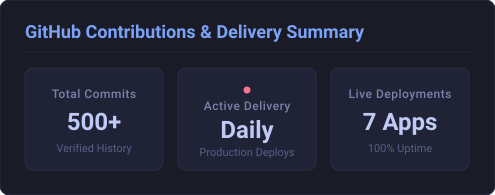

  # Yasmine Daoudi

  **Software Engineer &middot; Artificial Intelligence &amp; Big Data Systems**  
  *Distributed Streaming &middot; Neural Semantic Retrieval &middot; Full-Stack AI Architecture*

  
  
  
  

---

## About Me

I am a Software and AI Engineer passionate about architecting scalable distributed systems, deep learning pipelines, and spatial intelligence platforms. My work focuses on real-time stream processing (**Apache Kafka / Apache Spark / Databricks**), neural vector retrieval engines (**SentenceTransformers / PyTorch**), and clean-architecture conversational AI systems. Author of **4 single-author scientific preprints** indexed on Zenodo.

- **Deep Learning &amp; NLP:** Large Language Model applications, conversational agent architectures, neural semantic bi-encoders, CNNs, and acoustic phonetic analysis.
- **Big Data Engineering:** Real-time stream processing, Lambda architectures, multi-terabyte data warehousing, and unsupervised spatial clustering (K-Means, DBSCAN).
- **AI for Social Impact &amp; Geospatial Systems:** Mapping digital exclusion across 450,000 Moroccan 1 km&sup2; grid cells, and architecting offline-first educational systems.

---

## Single-Author Research &amp; Preprints (Zenodo)

1. **Silence as Data: A Lambda-Architecture Pipeline for Locating Digitally Invisible Communities on a 1 km&sup2; Grid of Morocco**  
   *Sole Author &middot; Preprint, Zenodo, 2026*  
   DOI: [10.5281/zenodo.23963589](https://doi.org/10.5281/zenodo.23963589)  
   *Kafka &middot; Apache Spark &middot; Databricks &middot; PostgreSQL &middot; Redis &middot; MLflow &middot; K-Means / DBSCAN*

2. **Hired: A Distributed Clean-Architecture Platform for Automated Career Intelligence and Conversational Interview Coaching**  
   *Sole Author &middot; Preprint, Zenodo, 2026*  
   DOI: [10.5281/zenodo.23963775](https://doi.org/10.5281/zenodo.23963775)  
   *Domain-Driven Design (DDD v13) &middot; React 19 &middot; FastAPI &middot; Three.js 3D Avatar &middot; Groq LLaMA 3.3*

3. **Polyglot: A Clean-Architecture, LLM-Powered Platform for Interactive Language Learning**  
   *Sole Author &middot; Preprint, Zenodo, 2026*  
   DOI: [10.5281/zenodo.23963920](https://doi.org/10.5281/zenodo.23963920)  
   *SuperMemo-2 (SM-2) Algorithmic Decay &middot; Web Speech API &middot; WebSocket State Machines &middot; PWA*

4. **Building a Business Intelligence Pipeline for GitHub Issue Analytics: Talend ETL, a MySQL Star Schema and Power BI**  
   *Sole Author &middot; Preprint, Zenodo, 2026*  
   DOI: [10.5281/zenodo.23964013](https://doi.org/10.5281/zenodo.23964013)  
   *Talend Open Studio &middot; Dimensional Modeling &middot; OLAP Star Schema &middot; DAX &middot; Power BI*

---

## When I code, I rely on

---

## Production Systems &amp; Verified Live Deployments

- **[Digital Shadows (Ombres Num&eacute;riques) - Lambda-Architecture Spatial GIS](https://github.com/yasmenmad/ombres-numeriques)**  
  *Big Data &amp; Spatial Machine Learning: Apache Spark, Kafka, Databricks, K-Means/DBSCAN, Gemini AI Policy Engine*  
  Processes and scores **450,000 spatial cells (1 km&sup2; grid)** across Morocco to detect digitally invisible rural populations lacking health, educational, and water infrastructure. Features interactive vector choropleths and automated Gemini AI territorial policy recommendations.  
  [Verified Live Deployment](https://yasmenmad.github.io/ombres-numeriques/) &middot; [Cartographie SIG](https://yasmenmad.github.io/ombres-numeriques/map.html) &middot; [Dashboard Analytique](https://yasmenmad.github.io/ombres-numeriques/dashboard.html) &middot; [Scientific Preprint](https://doi.org/10.5281/zenodo.23963589) &middot; [GitHub Source](https://github.com/yasmenmad/ombres-numeriques)

- **[Hired - Distributed Career Management &amp; 3D Conversational HR Avatar](https://github.com/yasmenmad/hired)**  
  *Enterprise Recruitment Platform: React 19, TypeScript, FastAPI, TalkingHead Three.js, Groq LLaMA 3.3, DDD v13*  
  Features Sara, an interactive 3D conversational interviewer avatar with real-time lip-synchronization, live candidate biometric emotion HUD, automated ATS CV scoring, and prompt-chained job-candidate matching.  
  [Verified Live Deployment](https://yasmenmad.github.io/hired/) &middot; [Scientific Preprint](https://doi.org/10.5281/zenodo.23963775) &middot; [GitHub Source](https://github.com/yasmenmad/hired)

- **[Polyglot - Intelligent Multi-Modal Adaptive Language Learning Platform](https://github.com/yasmenmad/polyglot-language-coach)**  
  *Educational Architecture: SuperMemo-2 Spaced Repetition (SM-2), Web Speech API, WebSocket State Machine*  
  End-to-end full-stack educational architecture integrating algorithmic memory decay scheduling, phonetics evaluation, and real-time multiplayer vocabulary tournaments.  
  [Verified Live Deployment](https://yasmenmad.github.io/polyglot-language-coach/) &middot; [Scientific Preprint](https://doi.org/10.5281/zenodo.23963920) &middot; [GitHub Source](https://github.com/yasmenmad/polyglot-language-coach)

- **[Filmo - Deep Learning Cinema Intelligence &amp; Neural Retrieval Engine](https://github.com/yasmenmad/chatbot)**  
  *Natural Language Processing: SentenceTransformer ('all-MiniLM-L6-v2'), PyTorch, Affective Valence Inversion*  
  Neural semantic vector retrieval system over curated IMDb film corpora. Embeds 384-dimensional dense semantic vectors and applies emotional valence inversion to proactively recommend heartwarming cinema when sadness or low mood is detected.  
  [Verified Live Deployment](https://yasmenmad.github.io/chatbot/) &middot; [GitHub Source](https://github.com/yasmenmad/chatbot)

- **[Echoes of History - Interactive Multi-Era Pedagogical Simulation Engine](https://github.com/yasmenmad/echoes-of-history)**  
  *Interactive Simulation: React 19, Vite, Groq LLaMA 3.3 70B, Web Speech API, 9 Historical Personas*  
  Simulates real-time vocal dialogue with Cleopatra, Nikola Tesla, Albert Einstein, Leonardo da Vinci, and Napoleon Bonaparte with contextual memory and eye-tracking geometry.  
  [Verified Live Deployment](https://yasmenmad.github.io/echoes-of-history/) &middot; [GitHub Source](https://github.com/yasmenmad/echoes-of-history)

- **[HanyuStar (&#27721;&#35821;&#26143;) - Interactive Mandarin Learning Client](https://github.com/yasmenmad/HanyuStar)**  
  *Mandarin Pedagogy &amp; Phonetics PWA: Hanzi Writer, HSK 1-4 Vocabulary, Pinyin Drills*  
  Interactive stroke order visualizer, character radical decomposition, and tone trainer for Chinese language learners.  
  [Verified Live Deployment](https://yasmenmad.github.io/HanyuStar/) &middot; [GitHub Source](https://github.com/yasmenmad/HanyuStar)

- **[Real Stories - Curated Historical Cinema Explorer](https://github.com/yasmenmad/REAL-STORIES)**  
  *Historical Cinema Archival &amp; Discovery Portal: TMDB REST API, Thematic Filtering, Chronological Eras*  
  Curated historical cinema discovery client indexing 85 true-story masterpieces across world history with full historical dossiers.  
  [Verified Live Deployment](https://yasmenmad.github.io/REAL-STORIES/) &middot; [GitHub Source](https://github.com/yasmenmad/REAL-STORIES)

- **[EnhancedBadgeApp - Port Logistics Intelligence &amp; Access Control](https://github.com/yasmenmad/anp-projects)**  
  *Industrial Data Analytics Tool for the National Ports Agency (ANP, Kingdom of Morocco)*  
  High-throughput batch Excel ingestion, normalized Levenshtein distance string matching, and statistical auditing.  
  [GitHub Source](https://github.com/yasmenmad/anp-projects)

---

### My GitHub contributions summary

  

 

### GitHub Stats &amp; Top Languages

  
  

---

### Verified Certifications

Click any certificate to inspect the authenticated credential:

-  &middot; [**Machine Learning for All &middot; University of London**](./certificates/cert_machine_learning_for_all_london.png)
-  &middot; [**Data Warehousing: Schema, ETL, and Optimal Performance &middot; Coursera**](./certificates/cert_data_warehousing_etl.png)
-  &middot; [**Power BI for Beginners &middot; Microsoft**](./certificates/cert_power_bi_microsoft.png)
-  &middot; [**Data Science &amp; Analytics &middot; HP LIFE Global**](./certificates/data_science_certificate.png)
-  &middot; [**Presenting Data &middot; HP LIFE Global**](./certificates/cert_hp_life_presenting_data.png)
-  &middot; [**Learn Object-Oriented Programming with PHP &middot; Coursera**](./certificates/cert_oop_php_coursera.png)
-  &middot; [**Hackathon Innovation &amp; Development Award**](./certificates/cert_hackathon_achievement.png)
-  &middot; [**Technical Engineering Internship Certificate**](./certificates/cert_technical_internship.png)
-  &middot; [**Scientific Seminar Presenter Certificate**](./certificates/certificate_seminar.png)

---

### Contact &amp; Connect

- **Email:** [yasmineedaoudii@gmail.com](mailto:yasmineedaoudii@gmail.com)
- **LinkedIn:** [linkedin.com/in/yasmine-daoudi-eng](https://www.linkedin.com/in/yasmine-daoudi-eng)
- **GitHub:** [github.com/yasmenmad](https://github.com/yasmenmad)
- **WeChat:** `madyamax05`
