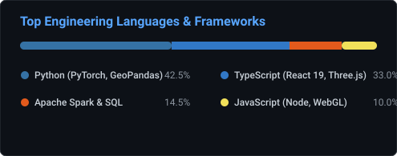

# Yasmine Daoudi

**Software Engineer & Applied Computer Science Researcher**  
*Distributed Systems | Neural Information Retrieval | Adaptive Pedagogical Technology | Offline-First Architectures*

---

## When I code, I rely on

### Languages & Core Runtimes

)

### Frontend Frameworks & Graphics

### Backend, APIs & Distributed Protocols

### Machine Learning, NLP & Analytics

### Databases, DevOps & Tooling

---

## Research & Technical Focus Areas

- **Adaptive Educational Systems:** Designing intelligent computer-assisted language acquisition architectures integrating SuperMemo-2 (SM-2) memory decay scheduling, automated speech evaluation via the Web Speech API, and context-aware conversational Large Language Models.
- **Neural Information Retrieval:** Developing hybrid dense-sparse retrieval systems combining transformer bi-encoder representations (`all-MiniLM-L6-v2`) with sparse TF-IDF inverted indexes and sentiment-calibrated ranking.
- **Offline-First Client Engineering:** Architecting resilient Progressive Web Applications (PWA) utilizing service workers, dynamic Cache API topologies, and stateful WebSocket synchronization for low-connectivity environments.
- **Operational Data Systems & GIS:** Engineering automated batch ETL pipelines, fault-tolerant fuzzy string matching algorithms, and choropleth geospatial models for public sector infrastructure assessment.

---

## Production Projects & Live Deployments

### [Polyglot - Intelligent Multi-Modal Adaptive Language Learning Platform](https://github.com/yasmenmad/polyglot-language-coach)
*Comprehensive Academic Thesis & Software Engineering Capstone Project*
- **Architecture:** React 18, TypeScript, Vite, Tailwind CSS, FastAPI (Python 3.12), SQLAlchemy, WebSockets, Web Speech API, Workbox PWA.
- **Algorithmic Core:** Implements the **SuperMemo-2 (SM-2)** spaced repetition algorithm for optimal memory retention, real-time phonetic feedback via the browser speech engine, and an asynchronous WebSocket state machine for live multiplayer tournaments.
- **Live Deployment:** [yasmenmad.github.io/polyglot-language-coach](https://yasmenmad.github.io/polyglot-language-coach/)
- **Academic Thesis:** [`Polyglot_Academic_Report_Final_v5.docx`](https://github.com/yasmenmad/polyglot-language-coach/blob/main/Polyglot_Academic_Report_Final_v5.docx)

---

### [Hired - Distributed Career Management & Application Automation Platform](https://github.com/yasmenmad/hired)
*Enterprise Recruitment & Career Automation Architecture with Sara 3D HR Avatar Engine (v13 DDD)*
- **Architecture:** React 19, TypeScript, Tailwind CSS 4, Vite 8, FastAPI (Python 3.12), SQLAlchemy, TalkingHead Three.js 3D Avatar Engine, Domain-Driven Design (Application, Domain, Infrastructure, Presentation layers).
- **Capabilities:** Interactive 3D conversational interviewer avatar with real-time lip synchronization, dual speech-viseme animation loop, layered repository pattern, asynchronous interview simulation, automated CV synthesis, and prompt-chained job-candidate matching.
- **Live Deployment:** [yasmenmad.github.io/hired](https://yasmenmad.github.io/hired/)
- **Repository:** [github.com/yasmenmad/hired](https://github.com/yasmenmad/hired)

---

### [Echoes of History - Interactive Multi-Era Pedagogical Simulation Engine](https://github.com/yasmenmad/echoes-of-history)
*Interactive Historical Simulation, Acoustic Phonetics & Adaptive Persona Retrieval*
- **Architecture:** React 19, Vite 7, Web Speech API, Groq (Llama 3.3 70B), Particle Systems, State Machine.
- **Capabilities:** 9 interactive historical figures (Napoleon Bonaparte, Cleopatra VII, Nikola Tesla, Leonardo da Vinci, Albert Einstein, Frida Kahlo, Genghis Khan, Marie Curie, William Shakespeare), in-character contextual memory, eye-tracking geometry, and dual online/offline conversational engine.
- **Live Deployment:** [yasmenmad.github.io/echoes-of-history](https://yasmenmad.github.io/echoes-of-history/)
- **Repository:** [github.com/yasmenmad/echoes-of-history](https://github.com/yasmenmad/echoes-of-history)

---

### [Filmo - AI Cinema Intelligence & Adaptive Recommendation Engine](https://github.com/yasmenmad/chatbot)
*Information Retrieval, Sentiment Calibration & Natural Language Processing System*
- **Architecture:** Python 3.11, Streamlit, Scikit-learn, Web Speech API, Interactive Client-Side Engine.
- **Algorithmic Core:** Emotion-adaptive recommendation engine that proactively detects sadness and low mood to curate heartwarming, uplifting comedies and inspiring adventures, paired with IMDb dataset indexing over 1,000 titles.
- **Live Deployment:** [yasmenmad.github.io/chatbot](https://yasmenmad.github.io/chatbot/)
- **Repository:** [github.com/yasmenmad/chatbot](https://github.com/yasmenmad/chatbot)

---

### [Ombres Numériques - Regional Infrastructure Intelligence & Spatial GIS](https://github.com/yasmenmad/ombres-numeriques)
*Geospatial Data Analytics & Socio-Economic Modeling for Morocco*
- **Architecture:** Node.js, Express, Leaflet.js, Chart.js, GeoJSON, Pro Dark GIS Interface.
- **Analytical Core:** Models composite Infrastructure Vulnerability Indices across Moroccan provincial territories with interactive vector layers, regional radar breakdowns, and real-time telemetry.
- **Live Deployment:** [yasmenmad.github.io/ombres-numeriques](https://yasmenmad.github.io/ombres-numeriques/) | [Cartographie SIG](https://yasmenmad.github.io/ombres-numeriques/map.html) | [Indicateurs Territoriaux](https://yasmenmad.github.io/ombres-numeriques/dashboard.html)
- **Repository:** [github.com/yasmenmad/ombres-numeriques](https://github.com/yasmenmad/ombres-numeriques)

---

### [EnhancedBadgeApp - Port Logistics Intelligence & Access Control](https://github.com/yasmenmad/anp-projects)
*Industrial Data Analytics Tool for the National Ports Agency (ANP, Kingdom of Morocco)*
- **Architecture:** Python, Pandas, Tkinter/ttk, Matplotlib, Scikit-learn.
- **Capabilities:** High-throughput batch Excel ingestion, normalized Levenshtein distance string matching, and statistical auditing.
- **Repository:** [github.com/yasmenmad/anp-projects](https://github.com/yasmenmad/anp-projects)

---

### [HanyuStar (汉语星) - Interactive Mandarin Learning Client](https://github.com/yasmenmad/HanyuStar)
*Client-Side Mandarin Pedagogy & Phonetics Application*
- **Architecture:** JavaScript (ES6+), HTML5, CSS3, Hanzi Writer, Progressive Web App (PWA).
- **Key Modules:** Character decomposition, stroke order visualizer, pinyin phonetics drills, and localized offline storage.
- **Live Deployment:** [yasmenmad.github.io/HanyuStar](https://yasmenmad.github.io/HanyuStar/)
- **Repository:** [github.com/yasmenmad/HanyuStar](https://github.com/yasmenmad/HanyuStar)

---

### [Real Stories - Curated Historical Cinema Explorer](https://github.com/yasmenmad/REAL-STORIES)
*Historical Cinema Archival & Discovery Client*
- **Architecture:** Vanilla JavaScript (ES6+), HTML5, CSS3, TMDB REST API.
- **Key Modules:** Thematic filtering of historical cinema archives, dynamic metadata rendering, and responsive multi-device design.
- **Live Deployment:** [yasmenmad.github.io/REAL-STORIES](https://yasmenmad.github.io/REAL-STORIES/)
- **Repository:** [github.com/yasmenmad/REAL-STORIES](https://github.com/yasmenmad/REAL-STORIES)

---

## Live Deployments Quick Index

| Project Name | Domain / Application | Verified Live Demo | Repository Source |
| :--- | :--- | :--- | :--- |
| **Polyglot** | Adaptive Multilingual Learning PWA (SM-2) | [Live Demo](https://yasmenmad.github.io/polyglot-language-coach/) | [`polyglot-language-coach`](https://github.com/yasmenmad/polyglot-language-coach) |
| **Hired** | Career Management & 3D Sara Avatar (v13 DDD) | [Live Demo](https://yasmenmad.github.io/hired/) | [`hired`](https://github.com/yasmenmad/hired) |
| **Echoes of History** | Multi-Era Historical Dialogue & Pedagogical Simulation | [Live Demo](https://yasmenmad.github.io/echoes-of-history/) | [`echoes-of-history`](https://github.com/yasmenmad/echoes-of-history) |
| **Filmo** | Emotion-Adaptive NLP Movie Recommendation | [Live Demo](https://yasmenmad.github.io/chatbot/) | [`chatbot`](https://github.com/yasmenmad/chatbot) |
| **Ombres Numériques** | Morocco Infrastructure GIS & Analytics | [Live Demo](https://yasmenmad.github.io/ombres-numeriques/) | [`ombres-numeriques`](https://github.com/yasmenmad/ombres-numeriques) |
| **HanyuStar** | Interactive Mandarin Learning Client | [Live Demo](https://yasmenmad.github.io/HanyuStar/) | [`HanyuStar`](https://github.com/yasmenmad/HanyuStar) |
| **Real Stories** | Historical Cinema Discovery Portal | [Live Demo](https://yasmenmad.github.io/REAL-STORIES/) | [`REAL-STORIES`](https://github.com/yasmenmad/REAL-STORIES) |

---

## Academic Thesis & Research Reports

- **Engineering Capstone Thesis:** *Polyglot: Design and Implementation of an Intelligent Multi-Modal Adaptive Language Learning Platform* ([Report Document](https://github.com/yasmenmad/polyglot-language-coach/blob/main/Polyglot_Academic_Report_Final_v5.docx))
- **End-of-Studies Internship Report (PFE):** *Rapport de Stage de Fin d'Études - Ingénierie Logicielle & Systèmes Distribués* ([Report Document](https://github.com/yasmenmad/polyglot-language-coach/blob/main/Polyglot_Rapport_Stage_Final.docx))

---

## Academic Credentials & Certifications

- **Machine Learning for All** - University of London
- **Introduction to Generative AI** - Google Cloud
- **Cybersecurity Awareness** - HP LIFE
- **Networking & IT Foundations** - Cisco Networking Academy

---

## GitHub Contributions & Engineering Activity

  

 

  
  

---

## Contact & Profiles

- **LinkedIn:** [linkedin.com/in/yasmine-daoudi-eng](https://www.linkedin.com/in/yasmine-daoudi-eng)
- **Email:** [yasmineedaoudii@gmail.com](mailto:yasmineedaoudii@gmail.com)
- **GitHub:** [github.com/yasmenmad](https://github.com/yasmenmad)
